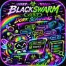

# ☣️ BLACKSWARM // Rainbow Skull Swarm




**RAINBOW DORK-STYLE RESEARCH · PUBLIC INDEXES · TERMINAL FIRST**

**GlitchByte Phantom Labs · Rainbow Skull Swarm Edition**

**Stable repository source: v0.5.7 · Cockpit preview: v0.6.5 (separate local build)**

**BLACKSWARM** is a free-first, terminal-led, multi-provider public-web and research-link discovery system. Discover public-index leads, follow live source progress in a vibrant rainbow terminal, organize research with saved sessions and topic constellations, explore bookmarks and collections, and export results locally. The optional **Swarm Cockpit** preview adds a graphical control room without replacing the original terminal.

## 💀 Skull Swarm identity

A neon, skull-themed research experience: obsidian black, electric violet, acid green, cobalt blue, cyan, hot magenta, and rainbow result streams. Publicly indexed information only; results are research leads, not verified facts or permission to access nonpublic systems.

## 🌈 Features

- Public-index research through Wikipedia, Crossref, Open Library, Internet Archive, Europe PMC, GDELT, and optional HTTPS SearXNG.
- Deduplication, relevance labels, focused/broad research, and excluded-candidate review.
- Rainbow **Swarm Constellation** visualizations, saved sessions, link drilldowns, and session comparisons.
- **Bookmarked Intel** favorites, notes, collections, collection radar, and tag nebula.
- Exports in CSV, JSON, HTML, or raw link formats.
- **Vault Guard** local backup and checksum verification for the user's own databases.

BLACKSWARM uses *dork-style research terminology*, but does **not** directly scrape Google or Bing, exploit targets, or scan private networks. Search operator support depends on the public provider.


## ☣️ Experimental Cockpit preview (v0.6.5)

The separate **v0.6.5 laboratory package** adds **[20] SWARM COCKPIT**, an opt-in local visual interface with working public-index search, provider progress, paginated results, filters, saved sessions, bookmarks, and exports. Searches and normal discovery remain accessible in the colorful terminal. The Cockpit opens a browser only when you explicitly choose its menu action or launcher.

The laboratory series also adds Source Pulse [15], Search Quality Lab [16], Smart Intent Lens [17], Precision Lens [18], and Concept Bridge [19]. Those ranking diagnostics are **heuristic previews**, not verification of source credibility. External providers can time out, return zero results, or change their terms. No commercial API key is required for the default public sources.

**Release status:** this repository's directly published source remains the approved **v0.5.7** version. The v0.6.5 Cockpit is a separately packaged test build and has **not** yet been adopted as the repository's stable source. Do not assume the checkout of `main` includes menu [20]. An updated local ZIP is being validated before a stable source promotion.

## 📖 Full BLACKSWARM manual

**[☣️ Open the complete BLACKSWARM USER MANUAL](MANUAL.md)** for detailed steps, examples, controls, submenu explanations, exports, troubleshooting, and privacy boundaries.

### 🌈 Every command-deck module

| Menu | Module | Description |
|:---:|---|---|
| **1** | **Live Public-Index Search** | Search multiple public research indexes; collect, rank, deduplicate, and save linked records. |
| **2** | **Offline Demo** | Learn with seven illustrative example URLs rather than live results. |
| **3** | **Saved Session History** | Look up your real saved Session IDs and previous research searches. |
| **4** | **Show All Links** | Review every saved selected link within a chosen session. |
| **5** | **Export Session** | Export CSV, JSON, HTML, or raw candidate CSV/JSON on request. |
| **6** | **Optional Dashboard** | Start a local web dashboard and print its URL without auto-opening a browser. |
| **7** | **Excluded Candidates** | Review collected URLs not selected by relevance filtering. |
| **8** | **Example Desk** | Get terminal help for Session IDs and search/export workflows. |
| **9** | **Swarm Constellation** | Explore colorful read-only charts of sources, domains, topics, and overlap. |
| **10** | **Session Delta** | Compare two saved sessions, identifying unique and shared URLs. |
| **11** | **Constellation Navigator** | Browse stored links by source, topic, domain, relevance, or quick-find; star interesting results. |
| **12** | **Bookmarked Intel** | Save favorites, update notes, search your shelf, and export selected bookmarks. |
| **13** | **Intel Collections** | Create curated folders and explore **Collection Radar**, **Collection Pulse**, and **Swarm Tags / Tag Nebula**. |
| **14** | **Vault Guard** | Preview local databases, create a private ZIP backup when confirmed, and verify backups without restoring. |
| **0** | **Quit** | Close the terminal application. |

Helpful quick guides: [Example Desk](EXAMPLE-DESK.txt) · [Bookmarks](BOOKMARKS-GUIDE.txt) · [Star Control](STAR-CONTROL-QUICKSTART.txt) · [Collections](INTEL-COLLECTIONS-GUIDE.txt) · [Collection Radar](COLLECTION-RADAR-GUIDE.txt) · [Swarm Tags](SWARM-TAGS-GUIDE.txt) · [Vault Guard](VAULT-GUARD-GUIDE.txt).

## 🐧 Run locally

Requires Python 3. The project is terminal-first. Its HTML dashboard is optional and does not launch automatically.

```bash
bash RUN-BLACKSWARM.sh --color always
```

Run offline tests:

```bash
python3 -m unittest discover -s tests -q
```

## 🔒 Privacy

Only approved source code, guides, and Skull Swarm artwork belong in this repository. **Never publish private research sessions, saved bookmarks, personal paths, databases, login tokens, keys, credentials, or Vault Guard backup archives.** Backups are unencrypted and must remain private.

The tested v0.5.7 source remains available in this repository. Rainbow Skull Swarm artwork is included as a repository thumbnail. No license has been selected.

**MADE WITH GLITCH LOVE // GLITCHBYTE PHANTOM LABS** 👻🦠💚💜
