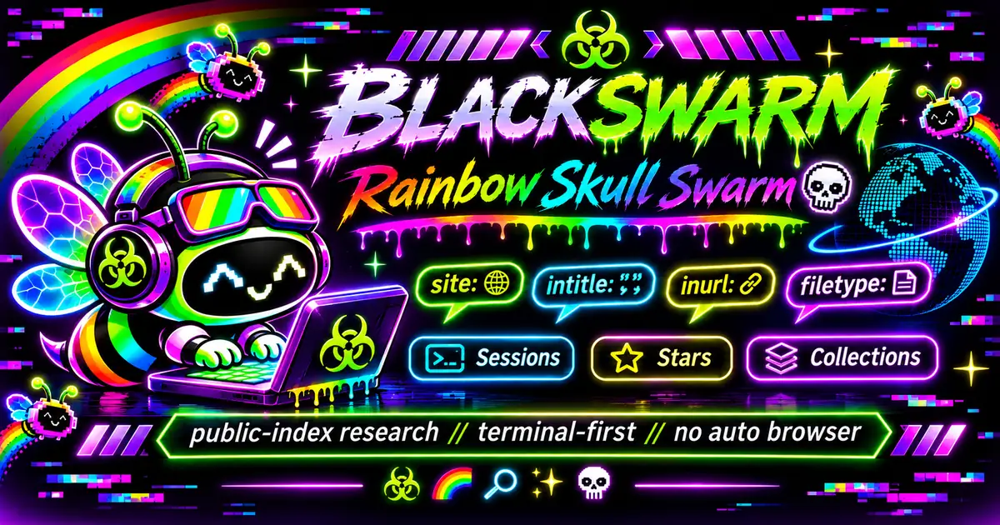
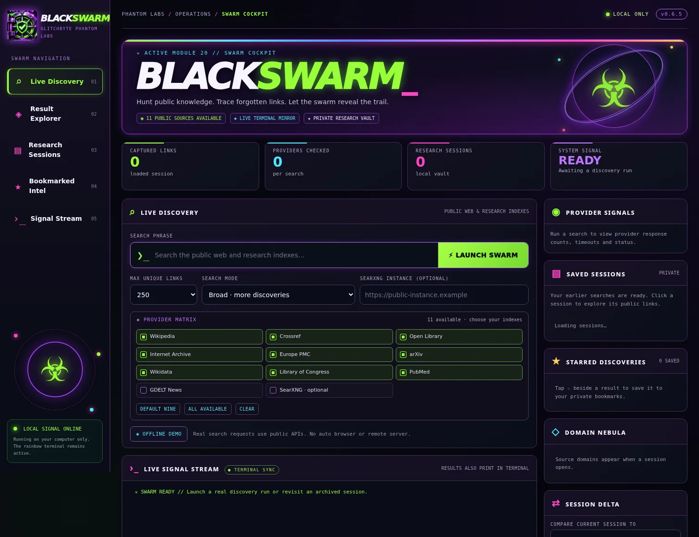

<div align="center">



# ☣️ BLACKSWARM // RAINBOW SKULL SWARM

### 🌈 Discover the public web. 🦠 Follow the signal. 💀 Keep the receipts.

**GlitchByte Phantom Labs** · **Linux / Python 3** · **Free-first public-index research** · **Rainbow terminal + local Swarm Cockpit**

[🚀 Quick start](#-launch-in-seconds) · [💜 See the cockpit](#-meet-the-swarm-cockpit) · [🧰 All 20 commands](#-the-full-20-command-deck) · [🔎 Real workflows](#-five-ways-to-explore) · [📖 Full illustrated guide](docs/MANUAL.md)

</div>

---

## 👾 What is BLACKSWARM?

BLACKSWARM gathers public search-index records into **one searchable research vault**. Run a multi-provider search, watch the sources report their results in your rainbow terminal, open a link, star a discovery, organize a collection, and export the links you want to revisit.

**This repository includes the complete v0.6.5 application source**, its **20-command terminal deck**, optional **Swarm Cockpit**, public-provider adapters, and offline tests. The Cockpit is a **local interface** served by BLACKSWARM on your own machine, not a hosted search service.

## ⚡ Launch in seconds

Requires **Python 3**. No paid API keys or third-party Python packages are required for the default providers.

```bash
git clone https://github.com/Hellfire13666/BLACKSWARM-SKULL-SWARM.git
cd BLACKSWARM-SKULL-SWARM
bash RUN-BLACKSWARM.sh --color always
```

Or use **Code → Download ZIP** on GitHub, extract it, and run `bash RUN-BLACKSWARM.sh --color always` inside the extracted folder. No system settings are changed.

**From the command deck:** press **`1`** for live public-index search, **`11`** to explore a saved session, or **`20`** to open your local visual Cockpit.

**Want the Cockpit directly?** Run `bash OPEN-SWARM-COCKPIT.sh`. The browser opens **only** when you explicitly select [20] or run the direct Cockpit launcher. Menu [6] still prints the local URL without opening a browser.

## 💜 Meet the Swarm Cockpit



*Screenshot of the real local interface in its initial, no-search state. Live totals and links come from your own research sessions, not a hosted database.*

| Cockpit zone | What you can do |
|---|---|
| **🔎 Live Discovery** | Enter a topic, pick sources, set 50–1,000 maximum links, choose search mode, and launch |
| **🌈 Live Signal Stream** | Watch provider activity mirrored from your terminal |
| **📚 Research Sessions** | Reopen saved searches by Session ID without rescanning |
| **🧭 Result Explorer** | View **20 links per page**; filter by title, snippet, source, and relevance |
| **⭐ Starred Discoveries** | Bookmark selected public links into your separate local favorites shelf |
| **🪐 Domain Nebula + Delta** | See source-domain counts and compare two saved sessions |
| **💾 Export** | Save a session's selected results as CSV, JSON, or HTML |

**The rainbow terminal keeps printing results** even when the Cockpit is open. The Cockpit binds to `127.0.0.1` on your computer; its link isn't a public URL for other people.

## 🧰 The full 20-command deck

| # | Module | What it does |
|:---:|---|---|
| **01** | 🔎 Live Public-Index Search | Collect and print public results from selected providers |
| **02** | 🧪 Offline Demo | Explore **7 illustrative URLs**, clearly marked as a demo |
| **03** | 🗓️ Session History | See prior searches and their Session IDs |
| **04** | 🔗 Show All Links | Print a saved session's selected links |
| **05** | 📦 Export Session | CSV, JSON, HTML, or raw candidate formats |
| **06** | 🌐 Optional Dashboard | Start localhost dashboard and print its URL **without** opening a browser |
| **07** | 🧹 Excluded Candidates | Review records that did not enter the selected results |
| **08** | 💡 Example Desk | Learn basic searching, session IDs, and controls |
| **09** | 🪐 Swarm Constellation | Read-only visual maps of saved domains, topics, and sources |
| **10** | 🔀 Session Delta | Compare overlap and differences between two searches |
| **11** | 🧭 Constellation Navigator | Explore by source, topic, domain, relevance, or Quick Find |
| **12** | ⭐ Bookmarked Intel | Star links, manage notes, and export favorites |
| **13** | 📂 Intel Collections | Curated folders, Collection Radar, Pulse, Swarm Tags |
| **14** | 🔐 Vault Guard | Explicit private backup and checksum verification; no automatic restore |
| **15** | 📡 Source Pulse | Read-only provider counts and search quality signals |
| **16** | 🧬 Search Quality Lab | Inspect stored relevance scores and candidate explanations |
| **17** | 🧠 Smart Intent Lens | Compare experimental whole-query rankings **without resaving** |
| **18** | 🎯 Precision Lens | Preview title-first matching and selection changes |
| **19** | 🌉 Concept Bridge | Preview related-title concepts in saved cybersecurity research |
| **20** | 💀 Swarm Cockpit | Launch the real graphical research interface locally |

**`0` quits.** Modules [15]–[19] explain or preview saved research; they don't manufacture extra URLs. [1] and the Cockpit's Live Discovery perform the actual searches.

## 🌍 Public provider matrix

| Default (press Enter) | Optional |
|---|---|
| Wikipedia · Crossref · Open Library · Internet Archive · Europe PMC · arXiv · Wikidata · Library of Congress · PubMed | GDELT News · a user-supplied public HTTPS SearXNG instance |

Provider availability is variable. A timeout is reported as a timeout, **not** as “zero results”; other providers continue. SearXNG expects an **HTTPS instance address**, not a search result or DOI URL. Dork-like operators such as `site:` or `filetype:` are not interpreted uniformly across these APIs.

## 🧪 Five ways to explore

### 1 · 🌐 Hunt public research with live links

Choose **[1]**, enter `cybersecurity incident response`, press Enter for nine default providers, choose **250** links, then **focused** mode. Watch per-provider URL previews appear in the rainbow terminal. The final result count depends on what each API actually returns.

### 2 · 🧭 Find a needle in 500 saved links

Choose **[11] → a Session ID → [5] QUICK FIND → `forensics`**. See only saved links whose title, URL, or snippet contains the term. Type a listed number for its stored metadata, or `f` to star an interesting link.

### 3 · ⭐ Create your own research trail

Star a result from Navigator or the Cockpit, then choose **[12] Bookmarked Intel** to edit its note. Use **[13] Intel Collections** to group saved research and browse by tags. Private bookmarks remain on your machine.

### 4 · 🔀 Compare two investigations

Run two related public searches, then choose **[10] Session Delta** and provide their Session IDs. Explore URLs present in one session, the other, or both. No extra provider requests are made by the comparison.

### 5 · 💜 Work visually with [20]

Choose **[20] SWARM COCKPIT**. Select sources, enter a topic, hit **LAUNCH SWARM**, then use Result Explorer for source and relevance filters, pagination, bookmarks and exports. Stop the local Cockpit with **Ctrl+C** in the hosting terminal.

> **Example output is always source-dependent.** The offline demo uses illustrative URLs; live source responses are public-index metadata, not independently verified page content or evidence of vulnerability.

## 📖 Full visual walkthrough and help

Read **[📘 BLACKSWARM USER GUIDE](docs/MANUAL.md)** for a step-by-step terminal map, Cockpit walkthrough, examples for every module, search modes, provider troubleshooting, privacy notes, and reference commands.

To run the bundled offline tests:

```bash
python3 -m unittest discover -s tests -q
```

## 🔒 Public research, private vault

BLACKSWARM searches public indexes and collects **public metadata and links**. It does not access restricted accounts, scan private networks, bypass site protections, or validate whether a target is vulnerable. Heuristic **HIGH / POSSIBLE / LOW** labels are about query matching, not trustworthiness, safety, or factual accuracy.

Research sessions, databases, private backup archives, local paths, tokens, credentials, and personal bookmarks are **not part of the repository**. Vault Guard archives are unencrypted: keep them private.

<div align="center">

**👻 MADE WITH GLITCH LOVE // GLITCHBYTE PHANTOM LABS 💚💜🌈**

</div>
