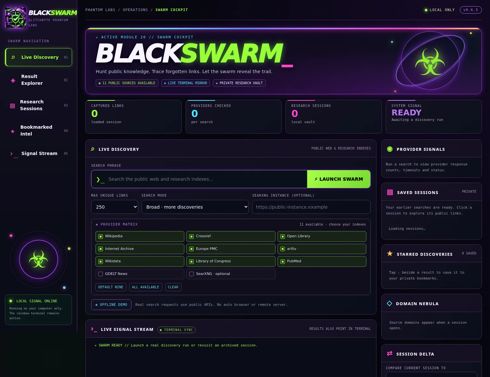

# 📖 BLACKSWARM // Rainbow Skull Swarm User Guide

**v0.6.5 · GlitchByte Phantom Labs · Terminal-first discovery + local Cockpit**

[Back to the colorful project homepage](../README.md) · [Cockpit preview](../assets/BLACKSWARM-COCKPIT-PREVIEW.webp)

## 🗺️ Find your route

| You want to... | Go here |
|---|---|
| Search the public indexes | [Live search](#-live-search-step-by-step) |
| Use the graphical control room | [Swarm Cockpit](#-swarm-cockpit-visual-tour) |
| Avoid scrolling 500 URLs | [Quick Find](#-constellation-navigator-walkthrough) |
| Save and organize finds | [Stars and collections](#-bookmarks-collections-and-tags) |
| Understand each of the 20 options | [Complete deck](#-complete-command-deck) |
| Compare searches | [Session Delta](#-compare-sessions-and-investigate-sources) |
| Fix an empty or timed-out provider | [Troubleshooting](#-troubleshooting) |

## 🐧 Install and start

You need a Linux terminal and Python 3, which is the only runtime dependency for the application itself. Use the GitHub **Code → Download ZIP** option and extract it, or:

```bash
git clone https://github.com/Hellfire13666/BLACKSWARM-SKULL-SWARM.git
cd BLACKSWARM-SKULL-SWARM
bash RUN-BLACKSWARM.sh --color always
```

Use the launcher from **inside the cloned/extracted directory**, or provide its full path. The application opens the rainbow **SWARM COMMAND DECK** without launching a browser automatically.

To explicitly open the local interface without selecting menu [20]:

```bash
bash OPEN-SWARM-COCKPIT.sh
```

For users who prefer plain text, `--color never` disables ANSI colors for the run. It does **not** alter terminal appearance settings.

## 💀 Your command deck at a glance

*Illustrative layout, with the real command numbers:*

```text
╔════ BLACKSWARM // GLITCHBYTE PHANTOM LABS ════╗
║     🌈  RAINBOW SKULL SWARM · PUBLIC INDEXES  ║
╚══════════════════════════════════════════════╝
  [1]   LIVE PUBLIC-INDEX SEARCH
  [3]   SAVED SESSION HISTORY
  [5]   EXPORT SESSION
  [9]   SWARM CONSTELLATION
 [11]   CONSTELLATION NAVIGATOR
 [12]   BOOKMARKED INTEL
 [13]   INTEL COLLECTIONS
 [15]   SOURCE PULSE
 [16]   SEARCH QUALITY LAB
 [17]   SMART INTENT LENS
 [18]   PRECISION LENS
 [19]   CONCEPT BRIDGE
 [20]   SWARM COCKPIT
  [0]   QUIT
  BLACKSWARM ❯ 1
```

The excerpt above intentionally omits some menu items for readability; the [complete command deck](#-complete-command-deck) documents all 20.

## 🔎 Live search step by step

1. Enter **`1`** at `BLACKSWARM ❯`.
2. Type your search topic, for example **`cybersecurity incident response`**.
3. At the sources prompt, press **Enter** to use all **nine default public indexes**, or specify comma-separated provider identifiers such as `wikipedia,crossref,arxiv`.
4. Choose a maximum of **50, 100, 250, 500, or 1,000** unique selected links. A limit is a *cap*, not a promised result count.
5. Choose **`focused`** (default), **`broad`**, **`intent`**, or **`precision`**.
6. Watch the live terminal print provider names, sample titles, source URLs and honest timeout/empty messages. Once finished, the session is saved with a **Session ID**.

### 🌈 Example terminal flow

```text
BLACKSWARM ❯ 1
Search phrase: cybersecurity incident response
Sources [Enter = nine free public indexes]:
Max unique links [50/100/250/500/1000; default 100]: 250
Quality [focused/broad/intent/precision; default focused]: focused
Checking WIKIPEDIA public index...
Checking CROSSREF public index...
...
VAULT SAVED  |  session #<assigned by your computer>
```

*Illustration of the prompts, not a live network test. The actual status, titles, counts and available links depend on provider responses.*

### 🧬 What do the search modes mean?

| Mode | Best use | Tradeoff |
|---|---|---|
| **focused** | Starting with stronger keyword matches | May omit more loosely related sources |
| **broad** | Discovering more tangential or archival leads | More irrelevant matches to review |
| **intent** | Favoring the whole search phrase | Experimental rule; can lower relevant partial matches |
| **precision** | Preferring stronger title matches | May overlook relevant papers with indirect titles |

These are **heuristic rankings**, not credibility checks, semantic proof, or factual verification. Use **[7]** to inspect the excluded candidate pool when search quality matters.

### 🌍 Provider identifiers

| Provider ID | Search area | Default? |
|---|---|:---:|
| `wikipedia` | Public encyclopedia topics | ✓ |
| `crossref` | Academic DOI and publication metadata | ✓ |
| `openlibrary` | Catalogs and public book metadata | ✓ |
| `archive` | Internet Archive public catalog records | ✓ |
| `europepmc` | Life sciences and health literature | ✓ |
| `arxiv` | Open research paper metadata | ✓ |
| `wikidata` | Public linked-data entity records | ✓ |
| `loc` | Library of Congress catalog and collection records | ✓ |
| `pubmed` | NCBI PubMed publication metadata | ✓ |
| `gdelt` | Public news-data provider | Optional |
| `searxng` | A user-provided public HTTPS SearXNG instance | Optional |

The **SearXNG Instance** field accepts a compatible public **HTTPS search server address**, not an article/DOI URL. For normal searches using the nine defaults, leave it blank. The optional SearXNG adapter is not a promise of Google/Bing coverage.

## 💜 Swarm Cockpit visual tour



*Screenshot of the actual v0.6.5 Cockpit at rest, with no private research data.*

```text
┌──────────────────────────── SWARM COCKPIT ────────────────────────────┐
│  LIVE DISCOVERY: topic  [ MAX LINKS ] [ QUALITY ] [ SOURCE MATRIX ]  │
│  [ LAUNCH SWARM ]                                                     │
│  ┌── LIVE SIGNAL STREAM ─────────┐  ┌── PROVIDER SIGNALS ─────────┐ │
│  │ progress and returned URLs    │  │ source counts / errors      │ │
│  └───────────────────────────────┘  └───────────────────────────────┘ │
│  ┌── RESULT EXPLORER ────────────┐  ┌── SAVED SESSIONS ────────────┐ │
│  │ search · filter · star · next │  │ past Session IDs             │ │
│  └───────────────────────────────┘  └───────────────────────────────┘ │
│  ⭐ BOOKMARKS           🪐 DOMAIN NEBULA           🔀 SESSION DELTA    │
└──────────────────────────────────────────────────────────────────────┘
```

To open: choose **[20]**, or run `bash OPEN-SWARM-COCKPIT.sh` from the source directory. The program starts a localhost server on an available port, prints a URL like **`http://127.0.0.1:<port>/`**, and opens the browser only because you explicitly asked for the Cockpit. A different person cannot open your localhost URL from their device.

**Inside the Cockpit:** enter a search topic, select providers (default nine or custom), choose link cap and quality, then click **LAUNCH SWARM**. Provider activity streams both to the terminal and the browser. In **Result Explorer**, filter titles/snippets, sources and relevance; go forward/back through **20 results per page**; open a URL or star it. From **Saved Sessions**, switch to a past search without rescanning, compare sessions with **Session Delta**, and export selected results as CSV/JSON/HTML.

**Stopping:** click the terminal that hosts the Cockpit, then press **Ctrl+C** once. From [20], this stops the local web server and returns to the command deck. Interrupting a still-running search can leave that search incomplete; earlier saved sessions remain.

**Alternative:** [6] starts the optional local dashboard and **only prints the URL**, leaving it to you to open a browser.

## 🧭 Constellation Navigator walkthrough

Suppose you saved a session of 500 public links but do not want to scroll 500 lines.

```text
BLACKSWARM ❯ 11
Session ID: <choose one from [3]>
[1] SOURCES
[2] TOPIC STARS
[3] DOMAIN NEBULA
[4] RELEVANCE
[5] QUICK FIND
CONSTELLATION ❯ 5
Search SAVED titles/URLs/snippets: forensics
```

The resulting view lists only local matches. In the **link-list pager**, use `n` and `p` for next/previous pages, type the displayed list number to inspect its stored metadata, `f` to star a result, or `b` to go back. **At the Constellation menu, type the menu number first**; typing the keyword before choosing [5] will not search.

Topic Stars [2] lets you pick a keyword from a frequency table. Domain Nebula [3] groups saved links by host. All of these operate on existing sessions without visiting the URLs again.

## ⭐ Bookmarks, collections and tags

- **[12] Bookmarked Intel:** star a discovered link, see your starred shelf, add or edit personal notes, and export favorites. The favorites database is separate from research sessions.
- **[13] Intel Collections:** group bookmarked links in named folders. Explore **Collection Radar** to find a link across collections, **Collection Pulse** to compare collection sizes, and **Swarm Tags / Tag Nebula** for labels and counts.
- **Cockpit star button:** tap ★ beside a live selected result to save it to the same local favorites shelf. Offline demo results are not real discoveries and cannot be bookmarked from the Cockpit.

For any read-only inspection, you can open saved links in your browser manually. BLACKSWARM does not automatically confirm that each link still works or that its content is accurate.

## 🔀 Compare sessions and investigate sources

**[10] Session Delta:** choose two distinct session IDs, then examine shared and unique URLs. This helps compare two related searches without performing another network request.

**[15] Source Pulse:** review how many public URLs each selected provider contributed, potential overlaps, and recorded timings/status when available. It explains the *search run*, not the reliability of the source's claims.

**[9] Swarm Constellation:** view local visual breakdowns of saved domains, source types and topical words. **[3] Session History** is your source of truth for saved Session IDs and past search phrases.

## 🧠 Ranking lenses, explained

These modules help you understand the results you've **already collected**. They do not add new public providers or invent URLs.

| Module | Use it for | Changes saved sessions? |
|---|---|---|
| **[7] Excluded Candidates** | Inspect collected URLs that did not enter the selected results | No |
| **[16] Search Quality Lab** | Explain stored HIGH / POSSIBLE / LOW rules candidate by candidate | No |
| **[17] Smart Intent Lens** | Preview whole-query ranking and which links would leave/enter | No |
| **[18] Precision Lens** | Preview title-anchored relevance, weaker title matches and selection changes | No |
| **[19] Concept Bridge** | Preview a small curated table of related cybersecurity title concepts | No |

**Example:** a paper about *malware classification* may be relevant to `cybersecurity` even without that exact word in the title. Concept Bridge can flag that relationship and name the matched phrase; it does **not** read the full paper or endorse its findings.

## 🧰 Complete command deck

| Menu | Feature | Quick use |
|:---:|---|---|
| **1** | Live Public-Index Search | Topic → providers → link cap → quality → saved session |
| **2** | Offline Demo | Practice with seven clearly illustrative URLs |
| **3** | Saved Session History | Read actual session IDs and queries |
| **4** | Show All Links | Print a session's selected URLs |
| **5** | Export Session | Export CSV, JSON, HTML, or candidate RAW data on demand |
| **6** | Optional Dashboard | Print local URL; no browser auto-launch |
| **7** | Excluded Candidates | Inspect results filtered out of the selected list |
| **8** | Example Desk | Read built-in menu/help examples |
| **9** | Swarm Constellation | Read-only source/topic/domain map |
| **10** | Session Delta | Compare saved URLs between two sessions |
| **11** | Constellation Navigator | Browse and search saved titles, links, and snippets |
| **12** | Bookmarked Intel | Star, note, search and export favorite links |
| **13** | Intel Collections | Folders, Collection Radar/Pulse and tags |
| **14** | Vault Guard | Deliberate private backup + checksum verification |
| **15** | Source Pulse | Provider contribution and status report |
| **16** | Search Quality Lab | Explain scores using stored candidate metadata |
| **17** | Smart Intent Lens | Read-only whole-query ranking preview |
| **18** | Precision Lens | Read-only title-first ranking preview |
| **19** | Concept Bridge | Read-only related title concepts |
| **20** | Swarm Cockpit | Open the local working graphical interface |
| **0** | Quit | Exit terminal BLACKSWARM |

## 💾 Exports and private backups

In **[5] Export Session**, choose a saved Session ID and the output format. CSV is friendly to spreadsheets, JSON for processing, HTML for a locally viewable report, and RAW for stored candidate-level exports where supported. Exports are made only when you request them.

In **[14] Vault Guard**, inspect private database status, explicitly confirm a backup, and verify a checksum manifest. This is **not** an automatic backup or restore. Backup ZIPs can contain private research and are **unencrypted**. Keep them off the public repository.

## 🐞 Troubleshooting

**The provider says `EMPTY`.** The API returned no candidates for that query. Try a shorter topic or another provider. `EMPTY` is not the same as `ERROR`.

**The provider says `ERROR` or timed out.** That index did not respond successfully for this run. Other selected providers can continue; you might try it again later. Library of Congress and news sources are not guaranteed to be online.

**I searched but got fewer than 1,000 links.** The limit is only a ceiling. Counts depend on provider coverage, filtering and URL deduplication.

**SearXNG fails.** Supply an actual compatible public **HTTPS SearXNG search instance**, not a DOI, an article URL, or a local/private network address. Or just use the nine default providers.

**The Cockpit page cannot open.** Use [20] again and inspect the printed `127.0.0.1` port. A localhost URL is accessible only on the machine running BLACKSWARM. [6] can print the URL without opening the browser.

**A README screenshot has no real results.** The illustrated preview shows the interface before a search. Live links come from your own providers, not a preloaded catalog.

**I want to stop the terminal feed.** `Ctrl+C` stops the running action and may stop the Cockpit server. If the search is still active, completing the search first gives it the best chance to save a full session.

**The rainbow display looks wrong.** Run with `--color always`, or use `--color never` for plain output. Neither changes your OS terminal theme.

**A result looks off-topic.** Try `focused`, `intent`, or `precision`, or review it via [7]/[16]–[19]. Research relevance and factual credibility are different questions.

## 🔒 Privacy, honesty, and testing

BLACKSWARM performs passive searches against supported **public indexes**. It is not a scanner, exploit tool, password collector, Google/Bing scraper, or access method for restricted systems. Many search operators are not supported by every catalog API. Provider metadata may be incomplete, misleading or outdated.

Research databases, saved bookmarks, personal paths, credentials, and local backup archives must remain private. The local Cockpit binds to `127.0.0.1`; sharing that address does not publish the service to the internet.

The **v0.6.5 source in this repository** includes a deterministic offline test suite:

```bash
python3 -m unittest discover -s tests -q
```

Passing offline tests does not guarantee that every external provider will be available during a live search.

**☣️🌈 GlitchByte Phantom Labs // Rainbow Skull Swarm // Search · Discover · Save · Explore**
